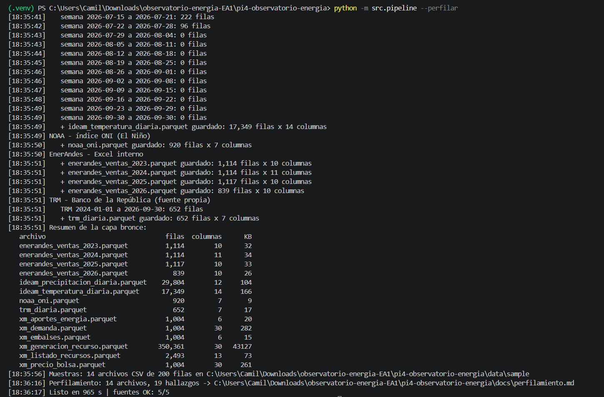
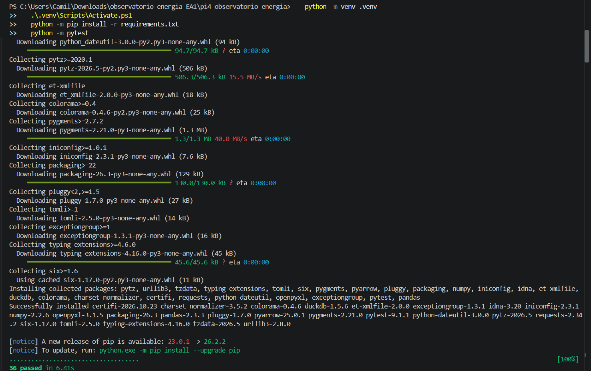

# Observatorio Energía y Clima

Proyecto Integrado IV – Integración de Información · IU Digital de Antioquia · 2026-2
EA1 – Extracción de datos de fuentes reales con Python (capa bronce)

## Integrantes

Proyecto individual. El único integrante asume los cuatro roles del reto: Data Engineer, Data Quality Analyst, Analytics Engineer y BI Analyst.

## Objetivo

Extraer datos del mercado eléctrico (XM), del clima (IDEAM y NOAA), de las ventas de EnerAndes y de una fuente propia (TRM) para analizar el riesgo energético de Colombia ante El Niño 2026. Los datos se guardan tal como llegan, sin limpiar, en Parquet y con su origen registrado (capa bronce).

Pregunta propia: ¿el precio del dólar presiona el precio de bolsa y el costo de compra de EnerAndes cuando entra generación térmica?

## Arquitectura

Fuentes → Bronce (Parquet + linaje) → Plata → Oro → Dashboard. Esta entrega cubre la capa bronce.

Cada archivo lleva tres columnas de linaje: `_fuente`, `_origen` y `_extraido_en` (UTC).

## Fuentes de datos

| Fuente | Tipo | Archivos en `data/bronze/` | Rango | Filas |
|---|---|---|---|---|
| XM | API REST | `xm_precio_bolsa`, `xm_demanda`, `xm_embalses`, `xm_aportes_energia` | 2024-01-01 a 2026-09-30 | 1.004 cada uno |
| XM | API REST | `xm_generacion_recurso` (generación por planta) | 2024-01-01 a 2026-09-30 | 350.361 |
| XM | API REST (`lists`) | `xm_listado_recursos` (catálogo de plantas) | sin fechas | 2.493 |
| IDEAM | API Socrata, SoQL | `ideam_precipitacion_diaria` | 2025-01-01 a 2026-09-30 | 29.804 |
| IDEAM | API Socrata, SoQL | `ideam_temperatura_diaria` (media, mínima y máxima) | 2025-01-01 a 2026-09-30 | 17.349 |
| NOAA | Archivo de texto | `noaa_oni` | serie completa | 920 |
| EnerAndes | Excel interno | `enerandes_ventas_2023` a `enerandes_ventas_2026` | 2023 a 2026 | 4.184 |
| TRM (fuente propia) | API Socrata | `trm_diaria` | 2024-01-01 a 2026-09-30 | 652 |

XM acepta máximo 30 días por consulta, por eso se pide por ventanas. El catálogo de plantas se consulta en el endpoint `lists`, sin fechas, y responde con la estructura `ListEntities`. En el IDEAM el filtro, la agregación por día y estación y el orden se hacen en el servidor con SoQL; no se descargan filas crudas.

### Fuente propia: TRM

La Tasa Representativa del Mercado (COP por USD) la publica el Banco de la República en datos.gov.co (dataset `32sa-8pi3`). Se usa porque las térmicas, que entran cuando bajan los embalses, dependen de combustibles y equipos cotizados en dólares. Cruzada con el precio de bolsa permite separar el efecto del clima del efecto del dólar (`consultas/06_precio_vs_trm.sql`).

## Cómo ejecutar

Requisitos: Python 3.11 o superior y conexión a internet. Desde la carpeta del repositorio:

Windows (PowerShell):
```powershell
python -m venv .venv
.\.venv\Scripts\Activate.ps1
python -m pip install -r requirements.txt
python -m src.pipeline --perfilar
```

macOS / Linux:
```bash
python3 -m venv .venv && source .venv/bin/activate
python -m pip install -r requirements.txt
python -m src.pipeline --perfilar
```

El Excel de EnerAndes ya está en `data/insumos/`. La primera ejecución tarda unos 16 minutos. Si se interrumpe, al repetir el comando solo se descargan las ventanas que faltan.

| Comando | Qué hace |
|---|---|
| `python -m src.pipeline` | Descarga lo que falte a `data/bronze/` y genera `data/sample/` |
| `python -m src.pipeline --forzar` | Vuelve a descargar todo |
| `python -m src.pipeline --solo xm trm` | Solo algunas fuentes: `xm`, `ideam`, `noaa`, `enerandes`, `trm` |
| `python -m src.perfilar` | Regenera `docs/perfilamiento.md` |
| `python -m src.consultar` | Consultas SQL con DuckDB sobre los Parquet |
| `python -m pytest` | Pruebas automáticas (no usan internet) |

## Capturas de la consola





## Estructura

```
data/insumos/    Excel de EnerAndes
data/bronze/     Parquet (no se sube a GitHub)
data/sample/     Primeras 200 filas de cada archivo, en CSV
src/config.py    Fechas, URLs, métricas y datasets
src/pipeline.py  Punto de entrada
src/common/      HTTP con reintentos, fechas, almacenamiento, cache de descarga
src/extract/     Un módulo por fuente: xm, ideam, noaa, enerandes, trm
consultas/       SQL sobre bronce
tests/           Pruebas con pytest
docs/            Perfilamiento y bitácora
```

## Perfilamiento y pruebas

`docs/perfilamiento.md` muestra, por cada archivo de bronce, las filas, columnas, tipos, porcentaje de nulos, duplicados y rango de fechas, además de los hallazgos de calidad con su evidencia numérica. La limpieza se hace en la capa plata.

`python -m pytest` ejecuta 36 pruebas: ventanas de fechas, aplanado del JSON de XM (incluido `ListEntities`), consultas SoQL, reintentos HTTP, idempotencia, reanudación, muestras de 200 filas, perfilamiento y consultas SQL.

## Limitaciones

- La temperatura del IDEAM no tiene datos desde el 29 de julio de 2026: las ventanas posteriores devolvieron 0 filas.
- Las APIs públicas pueden estar lentas o caídas; el pipeline reintenta y continúa con las demás fuentes.
- Bronce no corrige nada; los problemas de calidad se resuelven en la capa plata.